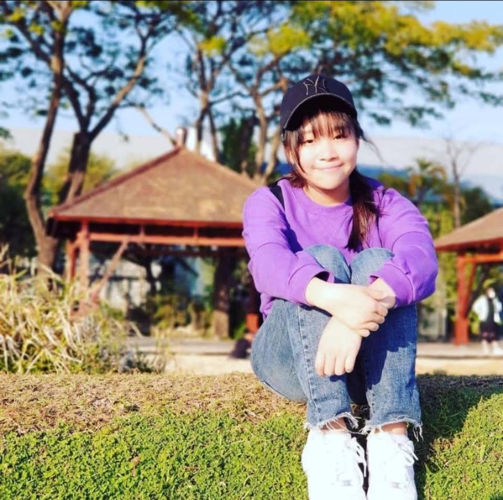
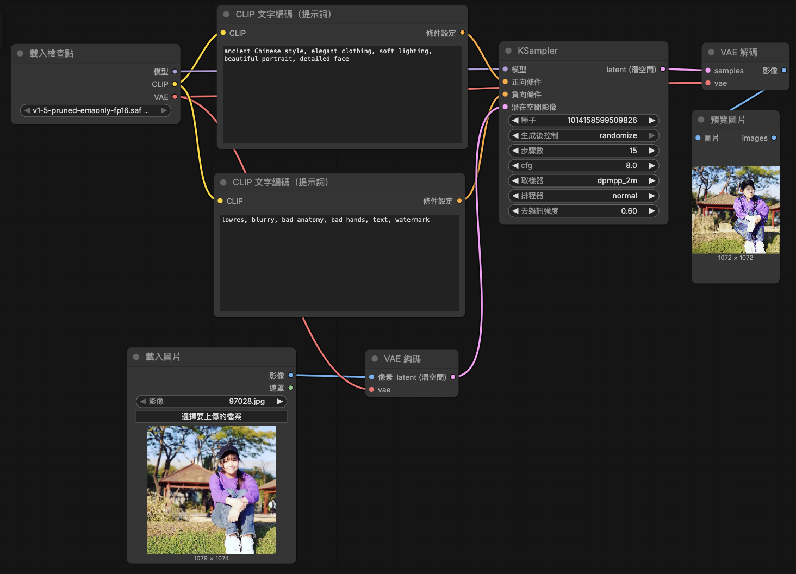

 ## 原圖 
  
 ## 生成圖
   
 ## 完整工作流截圖
    
 ### 正提示詞
 #### ancient Chinese style, elegant clothing, soft lighting, beautiful portrait, detailed face
 ### 反提示詞
 #### lowres, bad anatomy, bad hands, blurry, extra fingers, extra limbs, watermark, text, distorted face
 ## 心得
 #### 在運作的時候電腦風扇直接大啟動，整台發燙好恐怖😱而且生成的圖好拉哈哈哈💩但也是蠻有趣的～比GPT難用太多了做出來反而超級有成就感的😂